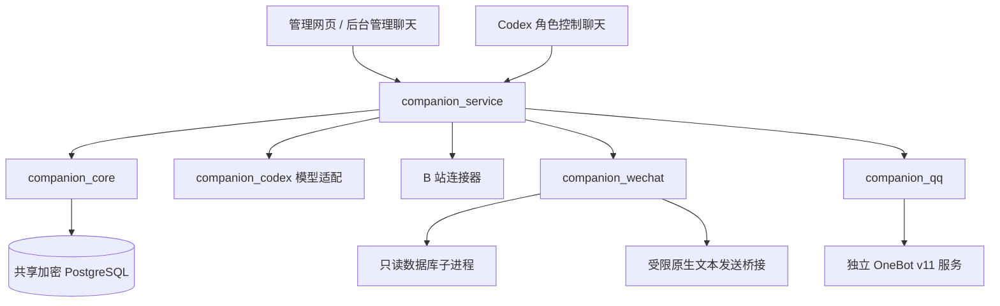

# 架构与模块边界

`companion_core` 定义人物资料、记忆治理、回复授权、额度、参与阶段和动作账本，不依赖 B 站、QQ、微信或 Codex。独立核心 wheel 的检查会阻止加载这些集成包，以验证解耦边界。

`companion_service` 是组装层，负责认证管理接口、平台生命周期、模型选择和调度。网页与管理聊天最终调用同一服务能力。`companion_codex` 负责宿主身份和模型调用；平台连接器负责协议解析、可信账号与目标识别、事件转换和发送回执。

微信与 QQ 通过 `ReplyTargetProvider` 提供已核验候选，核心按平台、机器人账号、会话类型和稳定目标 ID 管理回复权限。连接器不能用收到的文字、昵称或模型推断给自己授权。角色核心不直接访问平台客户端内存或 OneBot 网络接口。

数据库共用存储和事务能力，平台事件、游标、运行状态与动作记录保持独立命名空间。记忆读取继续检查作用域和授权；同一物理数据库不合并私人会话的访问边界。数据库中的敏感正文使用应用层加密，并由受限 PostgreSQL 账号访问；部分索引和运行元数据并不等同于整盘加密。

收件入账和游标推进采用原子提交。授权版本在消息接纳时固定，生成前和发送前复核；撤销后再授权不恢复旧请求。外发先记录意图，再提交一次；发送结果不明时保守停止，不把网络重连当作重新发送的理由。

新增平台应实现适配契约并注册到服务组装层，不复制角色、授权和记忆数据库。平台配置未就绪时保持不可用；安装、服务恢复和宿主重启不自动开启角色。
